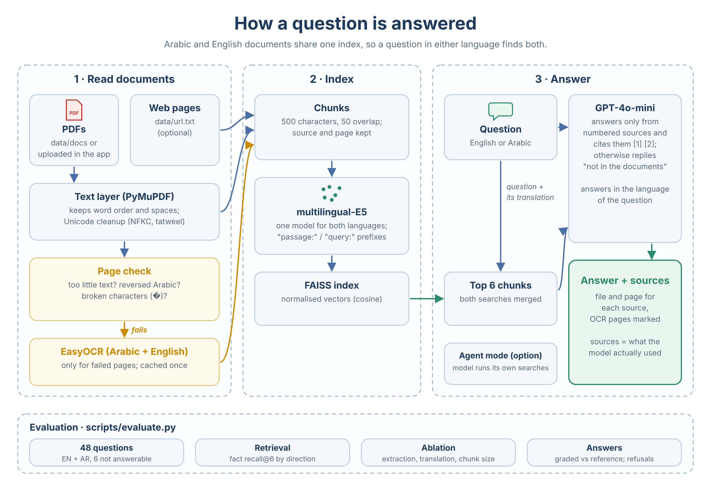

<div align="center">

# Bilingual RAG: Arabic–English Document Q&A

Ask questions in Arabic or English about Arabic and English documents, and get answers that cite the page they come from.

[](https://github.com/pradeepanpp/Bilingual-Arabic-English-RAG/actions/workflows/ci.yml)
[](https://www.python.org/)
[](https://www.langchain.com/langgraph)
[](https://streamlit.io/)

</div>

**Problem.** Many organisations in the Gulf keep documents in both Arabic and English, and the people asking questions often read only one of them. An English-speaking HR officer needs answers from the Arabic labour law; an Arabic-speaking analyst needs answers from English technical papers. Arabic PDFs add a second problem: their text layer is often unusable. Characters come out in reverse order or as broken glyphs, so a search index built from them silently fails.

**Solution.** A retrieval-augmented generation (RAG) pipeline with one multilingual index for both languages:

1. **Reading:** PyMuPDF extracts the text layer; every page is checked for missing, reversed or broken Arabic text, and only failing pages are read with EasyOCR (Arabic + English). OCR results are cached.
2. **Retrieval:** multilingual-E5 embeddings in FAISS. Each question is searched as asked and translated into the other language, and the two result lists are merged, so an English question finds Arabic passages and the reverse.
3. **Answering:** GPT-4o-mini answers only from numbered sources and cites them, or replies that the documents do not contain the answer. An optional agent mode lets the model run its own searches.

**Results** on 48 questions about a 100-page Arabic law and an English research paper: see [Results](#results).

**Stack:** Python · LangGraph · GPT-4o-mini · multilingual-E5 · FAISS · PyMuPDF · EasyOCR · Streamlit · pytest · GitHub Actions

---

## Results

_To be filled from `python scripts/evaluate.py --answers`._

### What went wrong with the Arabic PDF

The UAE labour law PDF (Federal Decree-Law No. 33 of 2021, 100 pages) has a text layer, but it is not usable as-is:

| Extraction | Example: "جدول المحتويات" (table of contents) |
|---|---|
| pdfplumber (first version of this project) | `تايوتحلما لودج` (every word reversed) |
| PyMuPDF text layer | `جدول املحتويات` (right order, but letter pairs swapped and about 1 broken character per 8 letters) |
| EasyOCR | `جدول المحتويات` |

97 of the 100 pages fail the page check and are read with OCR (5 of them are blank); none of the 15 pages of the English paper do.

---

## How it works

<p align="center">
  
</p>

| Step | Details |
|---|---|
| Page check | A page is OCR'd if it has under 80 characters, more than 1 broken character (`�`) per 100 Arabic letters, or reversed Arabic (more words end in "لا" than start with "ال") |
| OCR | EasyOCR, Arabic + English, 200 dpi; cached in `data/cache/` per file and page |
| Chunks | 500 characters with 50 overlap, split at paragraph, sentence and Arabic punctuation (، ؟) |
| Embeddings | `intfloat/multilingual-e5-small` with the `query:` / `passage:` prefixes the model was trained with |
| Search | The question and its translation (GPT-4o-mini) are both searched; the lists are merged with reciprocal rank fusion and the top 6 chunks are kept |
| Answer | Sources are numbered `[1] file, page n`; the model must cite them or say the documents do not contain the answer. The answer language is set in code from the question's script |

---

## Getting started

```bash
git clone https://github.com/pradeepanpp/Bilingual-Arabic-English-RAG.git
cd Bilingual-Arabic-English-RAG
uv sync                                # or: pip install -r requirements.txt
cp .env.example .env                   # add your OPENAI_API_KEY

python scripts/download_data.py        # the English paper used in the evaluation
uv run streamlit run streamlit_app.py
```

PDFs in `data/docs/` and web pages in `data/url.txt` are indexed at startup; more PDFs can be uploaded in the sidebar. The OCR cache for the Arabic law is included, so it starts without running OCR. New scanned or badly encoded PDFs are OCR'd once (tens of seconds per page on a CPU); `python scripts/prepare_documents.py` does this ahead of time.

**Evaluation**

```bash
python scripts/evaluate.py --answers                               # all setups + graded answers (a few cents)
python scripts/evaluate.py --model intfloat/multilingual-e5-base   # compare another embedding model
```

**Tests:** `pytest -q` (offline: fake LLM and fake embeddings; nothing is downloaded). CI runs lint and the tests on every push.

---

## Project structure

```
src/
├── document_ingestion/   PDF/web loading, page quality check, OCR cache
├── vectorstore/          multilingual-E5 + FAISS
├── nodes/                answer prompt, agent mode
├── graph_builder/        LangGraph workflow
└── evaluation/           retrieval and answer metrics
streamlit_app.py          UI with PDF upload and right-to-left layout
scripts/                  data download, OCR pre-processing, evaluation
data/eval/questions.json  48 evaluation questions with answer pages
tests/                    pytest suite
```

---

## Limitations and next steps

- The evaluation set is small (48 questions written for these two documents), so the confidence intervals are wide.
- Retrieval quality depends on OCR quality; EasyOCR occasionally splits or merges Arabic words.
- Answers are graded by GPT-4o-mini, the same model that writes them; a stronger or different judge would be fairer.
- OCR on a CPU is slow (tens of seconds per page), which is why results are cached.

Next: a reranker for cross-lingual questions, hybrid (keyword + vector) search for article numbers and exact terms, and a larger question set.
